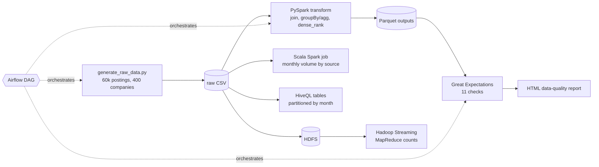

# Job Market Lakehouse

[](https://github.com/Deshraj-Jogiya/job-market-lakehouse/actions/workflows/ci.yml) 

A local-mode lakehouse pipeline over 60,000 synthetic job postings from 400 companies: PySpark transforms the raw data, Great Expectations
gates the output, Airflow orchestrates the run, a Scala Spark job adds a second aggregation, HiveQL tables partition the raw data by
month, and a Hadoop Streaming MapReduce job runs the same count over a single-node HDFS.

## Highlights

- **PySpark transformation:** joins postings to companies, aggregates salary statistics per industry and seniority (`groupBy`/`agg`), and
  ranks postings within each industry with a `dense_rank()` window function. Output is written as Parquet.
- **Data-quality gate:** 11 Great Expectations checks (row counts, categorical value sets, uniqueness, a cross-column `max >= min` rule).
  Any failed expectation fails the run.
- **Orchestration:** an Airflow DAG (`generate >> transform >> validate`) verified end to end with `airflow dags test`. A
  pydantic/typing_extensions conflict was fixed by giving Airflow its own environment, separate from the pipeline's.
- **Scala Spark job:** monthly posting volume by source, run through `spark-shell`.
- **Hive tables (HiveQL through Spark's Hive support):** an `EXTERNAL` text table over the raw CSV, a Parquet table `PARTITIONED BY`
  month filled with a dynamic-partition `INSERT OVERWRITE`, `MSCK REPAIR TABLE` to register a partition written straight to storage, and a
  month filter whose plan prunes partitions. In CI: 60,000 rows land in 20 partitions, the repair adds the 21st, and the June 2025 query
  reads one partition (3,015 rows).
- **Hadoop:** CI starts a single-node HDFS (NameNode and DataNode), loads the raw CSV into it and runs a Hadoop Streaming MapReduce job
  (Python mapper and reducer, 2 reducers) that counts postings per month and source. PySpark then reads the same file back from HDFS and
  the 100 MapReduce counts must match Spark's exactly.
- **Data-quality report:** a static HTML dashboard (pass/fail counts, segment counts, an average-salary chart in inline SVG) built from the
  same expectation results and uploaded by CI as an artifact.

## Architecture



## Stack

PySpark, Spark SQL, Scala, Apache Hive (HiveQL), Apache Hadoop (HDFS, MapReduce), Great Expectations, Apache Airflow, Parquet, pytest,
GitHub Actions.

## Run it

```bash
pip install -r requirements.txt        # Spark needs a JDK on PATH (CI uses Java 17)
python data/generate_raw_data.py
python spark_jobs/transform.py
python great_expectations/validate_outputs.py
python great_expectations/build_dashboard.py   # writes data/output/dashboard.html
python -m pytest tests/ -v
```

Hive tables (same JDK; the metastore is kept under `data/hive/`):

```bash
python spark_jobs/hive_tables.py
```

Hadoop job (needs an unpacked Hadoop release; CI uses 3.4.1 on Java 11):

```bash
HADOOP_HOME=/path/to/hadoop-3.4.1 bash hadoop/run_hdfs_mapreduce.sh
```

Scala job (needs a Spark distribution with `spark-shell` on PATH):

```bash
spark-shell -i spark_jobs/PostingTrends.scala
```

Airflow DAG, run in CLI test mode:

```bash
pip install "apache-airflow==2.10.2" --constraint <official-constraints-url-for-your-python-version>
export AIRFLOW_HOME=/tmp/airflow_home
mkdir -p "$AIRFLOW_HOME/dags" && cp dags/job_market_pipeline.py "$AIRFLOW_HOME/dags/"
airflow db migrate
airflow dags test job_market_pipeline 2026-01-01
```

## CI

`.github/workflows/ci.yml` runs the PySpark job, the HiveQL job, the Great Expectations validation and the tests on every push; a second job
installs Airflow and runs the DAG end to end; a third starts HDFS and runs the MapReduce job with its Spark cross-check. The Scala job is run by hand against a Spark distribution rather than in CI.

## Data

All data is synthetic and seeded (`data/generate_raw_data.py`); it describes no real company.
